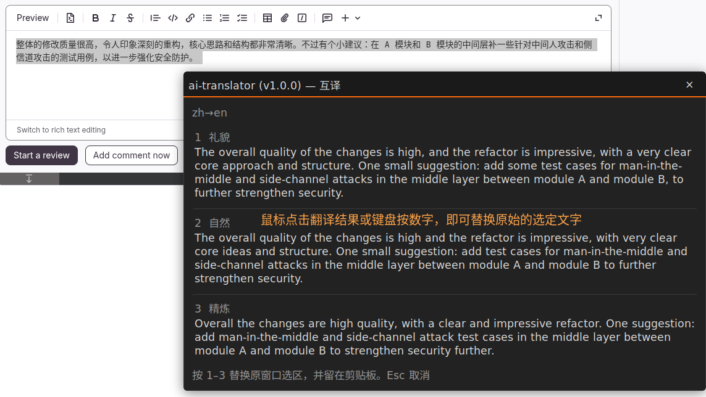

# ai-translator

划选文字后按下快捷键，即可弹出 AI 中英互译或润色，无需在软件间切换，帮助你保持专注、减少分心。支持多种风格，翻译或润色后的结果可以写回原文。

## 环境要求

Ubuntu 22.04 或 24.04，Xorg 会话登录，Python 3.10 到 3.15，GNOME 桌面。当前会话用下面的命令确认，输出应为 `x11`：

```bash
echo "$XDG_SESSION_TYPE"
```

不支持 Wayland。

## 安装依赖

在仓库目录执行：

```bash
sudo apt install python3-gi gir1.2-gtk-3.0 python3-xlib xdotool xclip
chmod +x ./ai-translator
```

## 配置

- 默认模型为 DeepSeek 的 `deepseek-flash`。请前往 [DeepSeek](https://platform.deepseek.com/api_keys) 获取 API key，并保存到 `~/.ai-translator/deepseek_key`。此项为必填，必须配置。文件里只放一行密钥，不要加引号。
- 可选配置位于 `config.toml`，按需调整。

## 注册快捷键

```bash
./ai-translator install-shortcuts
```

- 默认 Super+T 互译，Super+I 润色。如需替换，先修改 `config.toml`，再运行上面的命令。
- 快捷键若被占用，会弹出对话框，由用户决定是否替换。

## 使用

- `翻译`：在任何地方选定文字后按 Super+T 即可翻译，并支持替换选定文字。
- `润色`：在任何地方选定文字后按 Super+I 即可润色，并支持替换选定文字。
- 在不可写回的窗口中，翻译或润色后执行替换操作只会将内容复制到剪贴板。

## 界面


